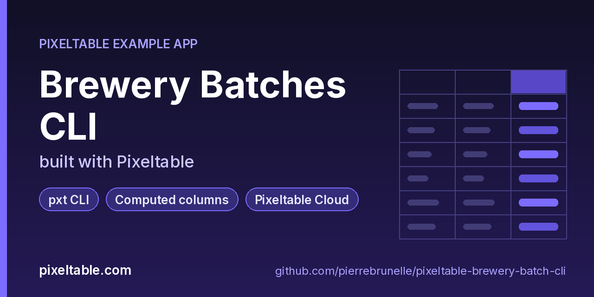

<!-- pixeltable-example-app: 20261117-brewery-batch-cli -->
# Brewery Batches CLI built with Pixeltable



[](https://codespaces.new/pierrebrunelle/pixeltable-brewery-batch-cli?quickstart=1)
[](https://pixeltable.com)
[](https://pypi.org/project/pixeltable/)
[](https://github.com/pixeltable/pixeltable)
[](LICENSE)

`Batches` holds one brew per row (style, volume, original gravity, optional final gravity); `abv` and `attenuation` are computed with `@pxt.expr_udf` functions that compile to plain expressions, so they stay NULL until the final gravity is known and fill in when `cli.py finish` records it. `Readings` is the fermenter log: every hydrometer reading gets a temperature-corrected gravity, degrees Plato and a fermentation stage (lag, active, slowing, terminal). `cli.py` also drives the `pxt` command line itself (`ls`, `describe`, `columns`, `computed`, `idxs`, `count`, `history`, `errors`, `whoami`, `logout` in a throwaway Pixeltable home, and a `feedback` preview that never sends) and shows `pxt.udf(table, return_value=...)` for wrapping a table as a function.

[Pixeltable](https://pixeltable.com) is open-source, Python-native **multimodal AI data infrastructure**: tables, incremental computed columns, UDFs, indexes and serving in one library, running locally or on Pixeltable Cloud.

> ⭐ **Like this example?** Star [pixeltable/pixeltable](https://github.com/pixeltable/pixeltable) on GitHub. It helps other developers find it.

## What this example shows

- **Incremental computed columns** powered by plain Python UDFs (`@pxt.udf`)
- **Pixeltable Cloud lifecycle** from the `pxt` CLI (`db`, `schema`, `service`)
- **B-tree indexes** declared on the model (`__indexes__`) back the lookup queries
- **`pxt` CLI** for inspecting and operating the catalog
- **Importable UDF module**: UDFs live in `udfs.py`; tables and queries live in `app.py` (Pixeltable resolves UDFs by module path)
- **`pixeltable.toml`** declares a local database and a **Pixeltable Cloud** database, so the same code deploys with `pxt db update`


## What's inside

| File | What it is |
|------|------------|
| `.devcontainer/devcontainer.json` | GitHub Codespaces / Dev Container config: Python 3.12, installs `requirements.txt` |
| `.github/social-preview.png` | Social preview image (1280x640) |
| `CITATION.cff` | Citation metadata (authors, license, release date, keywords) |
| `app.py` | Tables declared as Python classes and `@pxt.query` functions |
| `cli.py` | brewlog: a command-line tool for brewery batches, backed by Pixeltable |
| `pixeltable.toml` | Project config: the local database plus a Pixeltable Cloud database (sizing, deploy excludes) |
| `udfs.py` | Pixeltable UDFs (`@pxt.udf`) in their own importable module, imported by `app.py` |
| `requirements.txt` / `pyproject.toml` | Dependencies (`pixeltable>=0.7.24`) |

**Tables**

| Table | Stored columns | Computed columns |
|-------|---------|------------------|
| `batches` | `batch_id`, `name`, `style`, `brewed_on`, `volume_l`, `og`, `fg` | `abv`, `attenuation` |
| `readings` | `reading_id`, `batch_id`, `taken_at`, `gravity`, `temp_c`, `og` | `corrected`, `degrees_plato`, `phase` |

## Run in your browser (GitHub Codespaces)

[](https://codespaces.new/pierrebrunelle/pixeltable-brewery-batch-cli?quickstart=1)

1. Click **Open in GitHub Codespaces** above (or [this link](https://codespaces.new/pierrebrunelle/pixeltable-brewery-batch-cli?quickstart=1)). The dev container installs Python 3.12 and `pixeltable>=0.7.24` from `requirements.txt`.
2. In the codespace terminal, create the tables, seed them and run the app:

   ```bash
   pxt schema update app.py brew
   python cli.py seed                       # 6 batches + a fermentation curve of readings each
   python cli.py board                      # batches ranked by ABV; unfinished batches have no ABV yet
   python cli.py curve B-102                # corrected gravity, degrees Plato and stage per reading
   python cli.py read B-104 1.034 21.5      # log a reading (gravity, temperature in C)
   python cli.py finish B-104 1.012         # record the final gravity: ABV and attenuation fill in
   python cli.py calc 1.062 1.014           # the same maths through pxt.udf(table, return_value=...)
   python cli.py doctor                     # drive the pxt CLI: ls / describe / columns / idxs / count / history
   python cli.py --target pxt://<your-org>:<your-db> seed   # the same commands against Pixeltable Cloud
   ```


## Quickstart

Requires Python 3.11+ and `pixeltable>=0.7.24`.

```bash
git clone https://github.com/pierrebrunelle/pixeltable-brewery-batch-cli.git
cd pixeltable-brewery-batch-cli
python -m venv .venv && source .venv/bin/activate
pip install -r requirements.txt

# Create the tables in a local catalog directory named `brew`
pxt schema update app.py brew

python cli.py seed                       # 6 batches + a fermentation curve of readings each
python cli.py board                      # batches ranked by ABV; unfinished batches have no ABV yet
python cli.py curve B-102                # corrected gravity, degrees Plato and stage per reading
python cli.py read B-104 1.034 21.5      # log a reading (gravity, temperature in C)
python cli.py finish B-104 1.012         # record the final gravity: ABV and attenuation fill in
python cli.py calc 1.062 1.014           # the same maths through pxt.udf(table, return_value=...)
python cli.py doctor                     # drive the pxt CLI: ls / describe / columns / idxs / count / history
python cli.py --target pxt://<your-org>:<your-db> seed   # the same commands against Pixeltable Cloud
```

## Deploy to Pixeltable Cloud

The same `app.py` runs on [Pixeltable Cloud](https://pixeltable.com). Sign in (or get a free trial database with `pxt new`), point the second database entry in `pixeltable.toml` at your own database, then deploy:

```bash
pxt login                       # or: export PIXELTABLE_API_KEY=<your-api-key>
# edit pixeltable.toml: name = 'pxt://<your-org>:<your-db>'
pxt db update pxt://<your-org>:<your-db>                 # build the image and upload the project
pxt schema update app.py pxt://<your-org>:<your-db>       # create the tables at the database root (no per-app folder)
```

Keep keys in environment variables or `pxt secret set`, never in code.

## Code walkthrough

**1. Business logic is plain Python, in `udfs.py`.** A `@pxt.udf` function can be used as a column expression. Pixeltable records UDFs by module path (`udfs.temp_corrected_sg`), so they live in their own importable module rather than inline in the app: the daemon, serving workers and Pixeltable Cloud import it again by that path.

```python
# udfs.py
@pxt.udf
def temp_corrected_sg(sg: float, temp_c: float) -> float:
    """Correct a hydrometer reading to the 20 C calibration temperature."""
    f = temp_c * 9 / 5 + 32
    cal = 68.0
    k = lambda t: 1.00130346 - 0.000134722124 * t + 0.00000204052596 * t * t - 0.00000000232820948 * t**3  # noqa: E731
    return round(sg * k(f) / k(cal), 4)
```

**2. Tables are Python classes (`app.py`).** Annotated attributes are stored columns; attributes assigned an expression are **computed columns** (`corrected`, `degrees_plato`, `phase`), evaluated incrementally on every insert or update and recomputed when their inputs change. Indexes live next to the columns.

```python
# app.py
class Readings(TableModel, name='readings'):
    """One hydrometer reading of a batch in the fermenter, with the batch's OG copied on."""

    reading_id = pxt.Column(type=pxt.String, primary_key=True)
    batch_id: pxt.String
    taken_at: pxt.Timestamp
    gravity: pxt.Float
    temp_c: pxt.Float
    og: pxt.Float

    corrected = temp_corrected_sg(gravity, temp_c)
    degrees_plato = plato(corrected)
    phase = stage(corrected, og)

    __indexes__ = [pxt.BtreeIndex(batch_id)]
```

## Learn more

- 🌐 Website: https://pixeltable.com
- 📚 Docs: https://docs.pixeltable.com
- 💻 Source: https://github.com/pixeltable/pixeltable (⭐ star it if Pixeltable is useful to you)
- 📦 PyPI: https://pypi.org/project/pixeltable/
- 🧩 More example apps: https://pierrebrunelle.github.io/awesome-pixeltable-apps/

**[More Pixeltable example apps →](https://pierrebrunelle.github.io/awesome-pixeltable-apps/)**

---

<sub>Built as part of a daily series of Pixeltable example apps · Pixeltable 0.7.24 · Python, incremental computed columns · Licensed under Apache-2.0.</sub>
